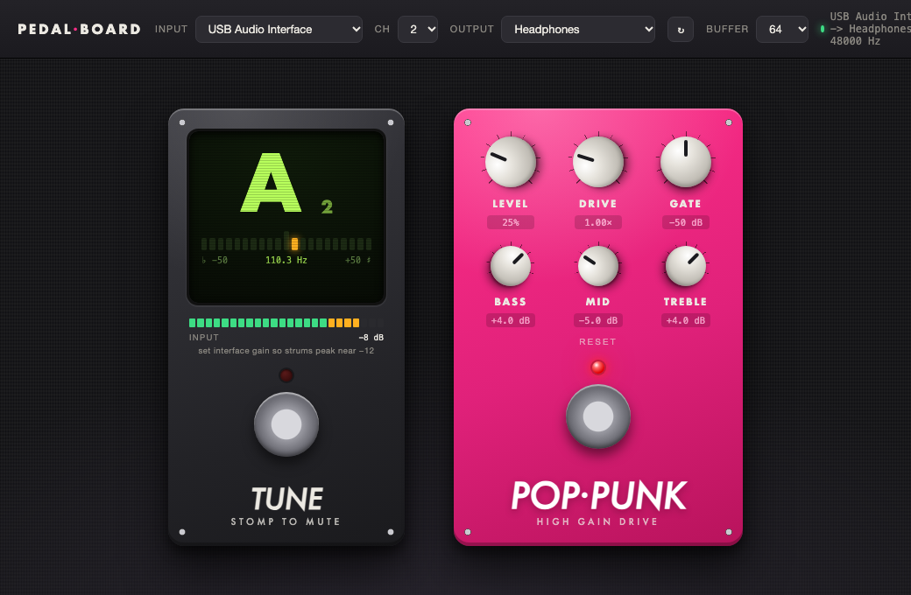

> **Disclaimer:** this is a vibecoded project. I'm learning guitar and didn't want to spend money on pedals, so I had an AI build me one. Expect rough edges.

# Pedal

A tiny desktop guitar pedal (Rust + Tauri). Plug your guitar into any audio interface, pick the input, channel and output, and play through a tuner plus a pop-punk high-gain drive with level, drive, gate, bass, mid and treble knobs.



## Run

```sh
cargo run --release
```

Needs Rust. Use headphones, and keep the buffer small for low latency.
